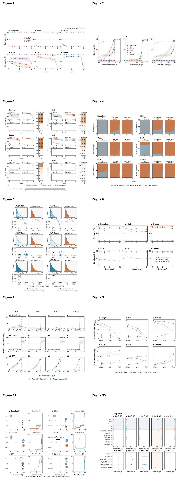

# Cooperation in language-model public-goods games

Figures, analysis-ready experimental results, figure source data and offline plotting code for **Incentives, communication and the time course of cooperation in repeated public goods games with language models**.

The experiments compare DeepSeek, Kimi, Claude, GLM, GPT and Gemini under changes in contribution incentives, public communication, termination rules, group size and reasoning settings. The release contains seven main figures and three supplementary figures. Model configuration and reasoning settings remain part of the scientific data.

## Contents

| Directory | Contents |
|---|---|
| `figures/main` | Figures 1–7 in PDF, SVG and PNG |
| `figures/supplementary` | Figures S1–S3 in PDF, SVG and PNG |
| `data` | Complete-group results, observed rounds, individual actions, condition summaries and figure source statistics |
| `code` | Offline analysis, plotting and figure verification |
| `docs` | Data dictionary, table inventory and figure captions |
| `previews` | Lightweight figure previews |

## Reproduce the figures

Requires Python 3.10 or later. Install the recorded dependencies and run from the repository root:

```sh
python -m pip install -r requirements.txt
python code/reproduce.py
```

To draw selected figures:

```sh
python code/reproduce.py --figures 1,3,S2
```

Generated figures are written to `reproduced/figures`. The supplied figures and input tables are preserved. Font availability affects typography on different systems.

## Recompute and verify results

```sh
python code/analyze.py
python code/analyze.py --rebuild-size-bootstrap
python -m pip install -r requirements_qa.txt
python code/verify.py --pdf-compare
```

The numerical checks reconstruct group means, condition summaries, communication contrasts and action-state proportions from the released records. The optional bootstrap command recomputes group-size confidence intervals. Estimates and intervals are retained at their original precision. The independent resampling unit is a complete group, including its participants and observed rounds. Confidence intervals use 10,000 within-condition bootstrap samples. Conditions are weighted equally in pooled comparisons.

## Reading the data

`contribution_rate` is contribution divided by endowment, between zero and one. Percentage and percentage-point fields are identified in the [data dictionary](docs/DATA_DICTIONARY.md). A fresh endowment is allocated each round. Accumulated payoffs do not enlarge the next round's contribution budget. Unobserved rounds after random termination are absent and are not coded as zero. `data/model_configurations.csv` explains the public configuration identifiers.

Only complete, valid results used in these analyses are included. Runtime logs, unsuccessful attempts, retry histories, service-routing information, authentication material and local file paths are excluded. Group and condition identifiers are consistent across tables. Independent repetitions are retained even when their observed contributions coincide. Tables can overlap because the same group contributes to several figures; do not concatenate overlapping tables as independent observations.

## Figures

See the [figure-to-data index](docs/FIGURE_INDEX.md) for each figure's input tables and plotting script.

Main figures cover contribution dynamics, incentives, public communication, action composition, random termination, group size and reasoning settings. Supplementary figures cover stage-specific communication effects, group-result distributions and task-condition variants. Captions and the table inventory identify the support of each comparison.



## 中文说明

本仓库提供7张正文图和3张补充图、干净的实验结果、作图源数据及离线分析与作图代码。保留模型、推理设置、参数、样本数和完整群体记录。去除运行日志、失败和重试记录、厂商渠道及原电脑路径。相同贡献结果的独立重复仍分别保留，不把它们当作重复数据删除。统计口径与各字段单位见[数据字典](docs/DATA_DICTIONARY.md)。

